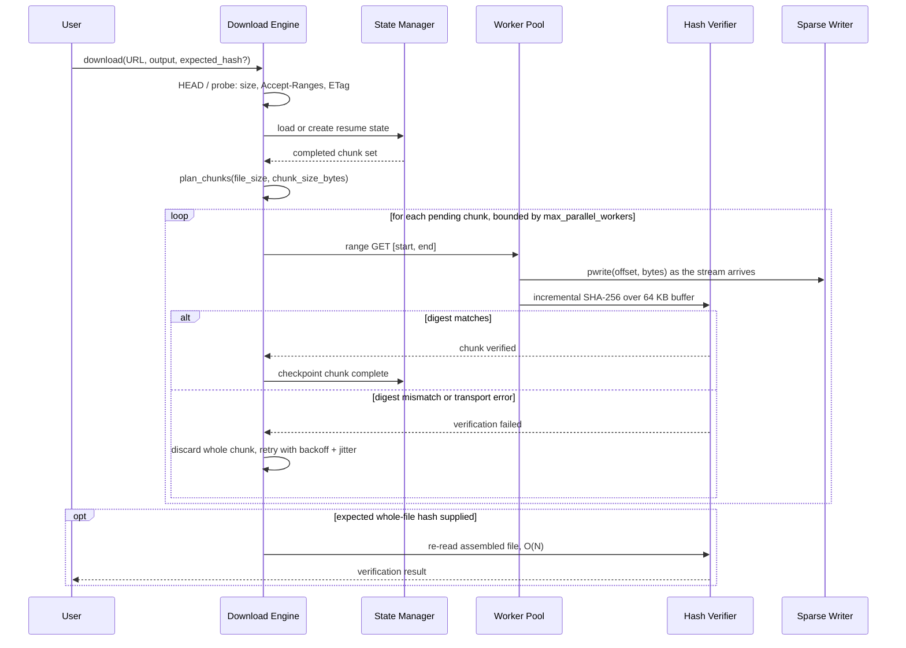
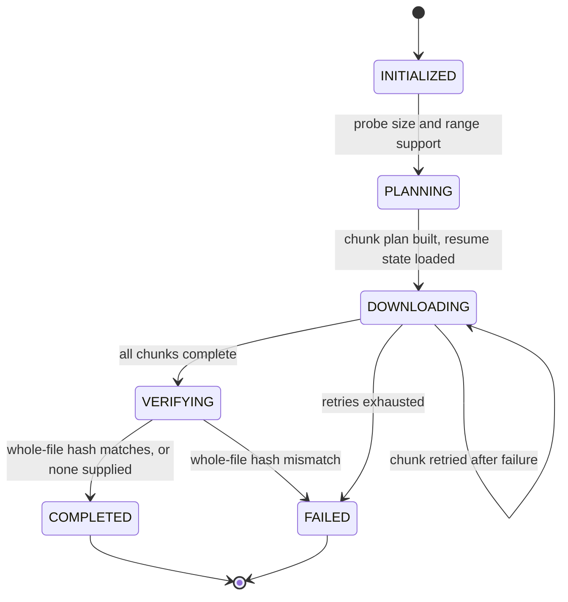
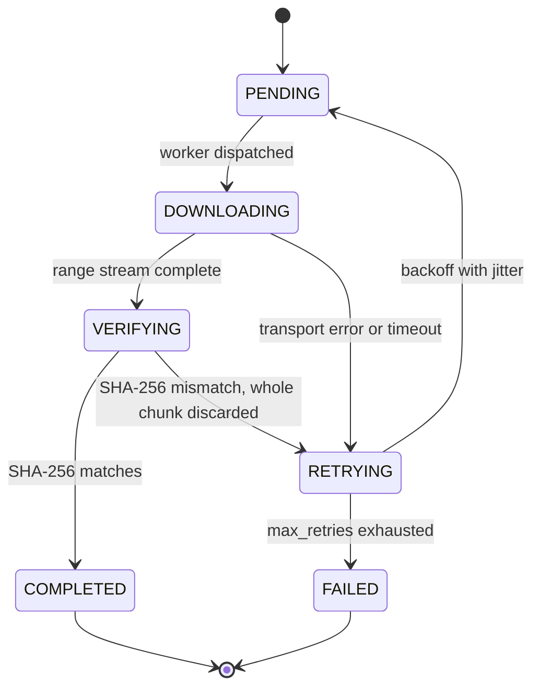

# 1. ReliaDL Data Flow and System Architecture

This document specifies the data flow, state transitions, and architectural interactions within the ReliaDL download system (formerly ChunkGuard).

## 2. End-to-End Sequence Architecture

The components involved, with their current integration status
(see [ALGORITHMS.md](ALGORITHMS.md) for provenance and open issues):

- **Transfer engine** *(wired)*: parallel HTTP range GETs with resume, per-chunk
  SHA-256 verification and atomic state checkpointing.
- **BL-DCS chunk sizing** *(library only)*: closed-loop chunk size from measured
  bandwidth, RTT and loss.
- **EXP3.S mirror routing** *(library only)*: adversarial-bandit selection among
  replicas, with a circuit breaker and health monitor.
- **Straggler detection and range bisection** *(library only)*: splits the unfetched
  remainder of a lagging chunk.
- **Merkle tree over chunk hashes** *(manifest and CLI audit only)*: inclusion proofs
  in Ed25519-signed manifests.

No forward error correction, homomorphic hashing, or restless-bandit scheduling is
implemented. Earlier revisions of this document claimed all three.




## 3. State Machine Formalisms

### 3.1 Download State Machine




### 3.2 Chunk State Machine




## 4. Data Path Formulations

### 4.1 Chunk Download and Hashing

Each worker issues an HTTP range GET and streams the response, computing an incremental
SHA-256 over a 64 KB buffer as bytes arrive. Bytes are written at their absolute offset
via `os.pwrite` through `SparseFileWriter`, so no reassembly pass is needed.

The chunk size is currently a fixed configuration value. The BL-DCS controller
(`algorithms/adaptive_chunker.py`) computes a size from measured bandwidth, RTT and
loss, but is **not yet called by the engine** — see
[ALGORITHMS.md](ALGORITHMS.md#1-bl-dcs-bandwidth-loss-closed-loop-dynamic-chunk-sizing).

### 4.2 Verification

On arrival, each chunk's digest is compared against the expected value with
`hmac.compare_digest`. A mismatch discards the whole chunk and re-fetches it.

Whole-file verification, when an expected digest is supplied, re-reads the completed
file from disk — an O(N) I/O pass.

> Earlier revisions of this section described a second hash layer (LtHash) giving O(1)
> whole-file verification by summing chunk hashes, and a Merkle localization path that
> avoided full chunk re-transmission. **Neither is implemented.**

## 5. Concurrency and Scheduling

Workers are drawn from a bounded pool (`max_parallel_workers`) and pull pending chunks
from shared state; `httpx` connection limits are set to match the pool size.

EXP3.S mirror routing (`algorithms/mirror_bandit.py`) and straggler detection with
range bisection (`algorithms/work_stealer.py`) are implemented and unit-tested but are
**not yet called by the engine**.

## 6. Error Recovery

Transient failures are retried with exponential backoff and jitter
(`download_engine.py:643-652`). A chunk that fails verification is discarded and
re-fetched in full. Completed chunks are checkpointed to the resume state file, so an
interrupted transfer resumes at chunk granularity rather than restarting.

There is no forward error correction and no sub-chunk corruption localization on the
download path.


### 6.1 Error Propagation Flow

```
  Error occurs in Worker
         │
         ▼
  ┌──────────────────────────────────┐
  │  Classify error                  │
  │  - Is it retryable?             │
  │  - What's the HTTP status?       │
  │  - What exception type?          │
  └──────────┬───────────────────────┘
             │
        ┌────┴────┐
        │         │
   Retryable  Non-Retryable
        │         │
        ▼         ▼
   Increment   Mark chunk
   attempt     ABANDONED
   counter         │
        │         ▼
        ▼    Log error with
   Compute   full context
   backoff       │
   delay         ▼
        │    Check: are ALL
        ▼    chunks ABANDONED?
   Sleep &       │
   retry    ┌────┴────┐
             │         │
            NO        YES
             │         │
             ▼         ▼
          Continue   Mark download
          (other     as FAILED
          chunks     Notify user
          may        via callback
          succeed)   & exit code
```

---

## 7. Direct Sparse Write Data Flow

```
Download Initialized (--direct-write)
       │
       ▼
[ Pre-allocate target file ] ──▶ posix_fallocate(fd, 0, file_size)
       │
       ▼
[ Launch Worker Coroutines ]
       │
       ├── Worker 0 ──▶ fetch chunk 0 ──▶ verify SHA-256 ──▶ os.pwrite(fd, buf, 0)
       ├── Worker 1 ──▶ fetch chunk 1 ──▶ verify SHA-256 ──▶ os.pwrite(fd, buf, 8388608)
       └── Worker N ──▶ fetch chunk N ──▶ verify SHA-256 ──▶ os.pwrite(fd, buf, offset_N)
       │
       ▼
[ All Chunks Verified & Written ]
       │
       ▼
[ os.fsync(fd) & Whole-File SHA-256 Check ]
       │
       ▼
[ Download Complete — Zero Assembly Delay ]
```

---

## 8. Manifest-Driven Verification Flow

```
[ User provides .cgmanifest ]
       │
       ▼
[ Verify Cryptographic Signature (Ed25519) ]
       │
       ├── [FAIL] Signature Invalid ──▶ Abort (Untrusted Manifest)
       └── [PASS] Signature Valid   ──▶ Load pre-authenticated chunk hashes & mirrors
                                          │
                                          ▼
                             [ Concurrent Range GETs ]
                             [ across prioritized mirrors ]
                                          │
                                          ▼
                             [ Per-chunk SHA-256 checked ]
                             [ against signed manifest ]
                                          │
                                          ▼
                             [ Match Merkle Tree Root ]
                                          │
                                          ▼
                             [ Success — Cryptographic Proof ]
```
